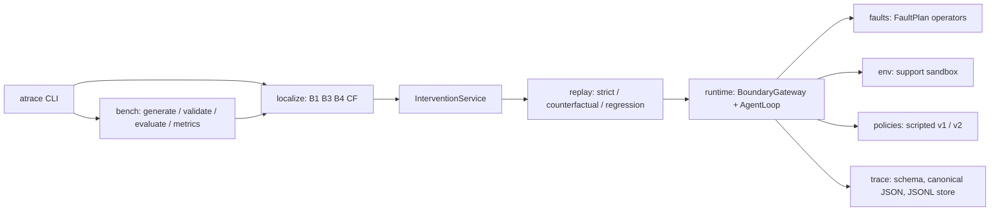

# AgentTrace AI

**Deterministic record/replay, controlled counterfactual interventions and failure diagnosis for tool-using AI agents.**

> **Status: deterministic MVP, Weeks 1–4 complete.** Everything listed under *What works* is implemented and tested. The benchmark freeze was approved and the held-out test split was evaluated **once** (results below; protocol in `FREEZE.md`). Release blockers and owner decisions: [`docs/RELEASE.md`](docs/RELEASE.md).

## Why
When a tool-using agent fails, a trace shows *what* happened, not *which step is responsible*. The first visible error is often not the cause. Re-running a "fixed" agent against replayed responses can falsely report success. Stateful tools and nondeterminism make honest reproduction hard.

AgentTrace answers four questions with explicit guarantees:
1. **Can I reproduce this run exactly?** Strict replay re-executes every tool against a restored state and fails closed at the first divergence.
2. **Which single step, if replaced, repairs the run?** Typed counterfactual interventions, each paired with a placebo control.
3. **Does my fix really work?** Regression execution runs the candidate freshly; it never reuses recorded responses.
4. **How good is a localizer?** A validated fault-injection benchmark with separate localization, repair and evidence metrics.

No novelty is claimed for replay-based failure attribution, which has substantial prior work.

## What works (v0.1.0rc1)
- **Tracing:**
  - versioned trace schema with an observable trace and a privileged ledger;
  - canonical JSON and SHA-256 fingerprints;
  - hash-chain integrity, plus an atomic JSONL store.
- **Sandbox environment:** synthetic customer support / order management with 5 tools, transactional commits, idempotency, snapshot/restore and 8 scenario templates.
- **Fault injection:** a serializable `FaultPlan` with stage-declared operators:
  - timeout before execution, lost acknowledgement after commit;
  - corrupted output, wrong retrieval;
  - wrong tool, wrong argument, decoy read, decision replacement.
- **Replay modes:**

  | Mode | What it does |
  |---|---|
  | `REPLAY_STRICT` | exact, verified replay |
  | `REPLAY_INTERVENE` | observation vs. execution replacement, trusted references only, a cassette fence, a fresh downstream run, same-type placebo, explicit `UNSUPPORTED` |
  | `REGRESSION` | fresh candidate runs from the scenario and environment fixture only |

- **Localizers:**
  - B1 earliest visible error, B3 rule-based, B4 earliest reference deviation, CF placebo-controlled counterfactual;
  - evidence labels `SUSPICION` / `REFERENCE_DEVIATION` / `INTERVENTIONAL_REPAIR` / `UNSUPPORTED`; CF run conclusion `repair sites`, `NOT_ISOLATED` (failed, no single-step repair) or `NO_FAILURE` (the run passed).
- **Benchmark and evaluation:**
  - AgentTrace-Synth v0: 67 validated instances, dev/test split by template;
  - `atrace bench run` with Metrics A/B/C, Wilson intervals, byte-identical canonical outputs and built-in correctness checks.

## Quickstart
Requires [uv](https://docs.astral.sh/uv/) and Python 3.12 (uv can install it). Verified on an 8 GB MacBook Air M2: offline, no GPU, no paid API.
```bash
uv sync --locked
make demo                          # scripted 3-minute tour (press Enter between steps)
DEMO_NONINTERACTIVE=1 make demo    # same, non-interactive
```
Individual commands:
```bash
uv run atrace scenarios                      # list scenario templates
uv run atrace run T1                         # clean run: trace + oracle verdict
uv run atrace inject T1-D1+F4                # record a fault-injected benchmark instance
uv run atrace show <run_id>                  # reload + integrity check
uv run atrace replay <run_id>                # strict replay verification
uv run atrace investigate <run_id> --markdown report.md
uv run atrace intervene <run_id> --seq 11 --type execution   # intervention + placebo
uv run atrace regress <run_id> --policy v2   # fresh candidate runs, no cassette reuse
uv run atrace bench run --split dev          # Metric A/B/C on the development split
```
A guided example is in [`docs/WALKTHROUGH.md`](docs/WALKTHROUGH.md).

Exit codes:

| Command | Exit codes |
|---|---|
| `run` | 0 PASS, 1 FAIL, 2 error |
| `replay` | 0 VERIFIED, 1 DIVERGED, 3 CONFIG_MISMATCH, 4 INTEGRITY_ERROR |
| `intervene` | 0 completed, 5 UNSUPPORTED, 6 INVALID_COUNTERFACTUAL |
| `regress` | 0 deterministic candidate PASS, 1 otherwise |
| `bench run` | 1 on any correctness violation; 2 when the guarded test split refuses |
| `inject`, `investigate`, `intervene` | 2 for a held-out (test-split) case without `--allow-held-out` |

The held-out split is guarded (operational safeguard, not a security control): `bench run --split test` needs `--approved-commit <full hash>` and `--confirm-single-test-run`, at the frozen commit with a clean tree. It refuses a second official run. Details: [`docs/EVALUATION.md` §7](docs/EVALUATION.md).

## Architecture

Localizers see only the observable trace and the `InterventionService`, never labels, ledgers or fault plans. This is enforced by tests. Details: [`docs/ARCHITECTURE.md`](docs/ARCHITECTURE.md). Replay contracts: [`docs/REPLAY_SPEC.md`](docs/REPLAY_SPEC.md). Data contracts: [`docs/TRACE_SCHEMA.md`](docs/TRACE_SCHEMA.md).

## Results
**Held-out test split** (official single run at the freeze `bench-freeze-v0` = `eb6d95c`, frozen 0.1.0rc1 implementation; `evaluation/synth_v0-test/`). 37 instances from the 4 held-out templates, **22 eligible** CAUSAL single-site instances. Each cell is k/n [Wilson 95% CI]; MRR with template-bootstrap CI.

| Method | Top-1 (primary) | Top-3 | MRR | Top-1 same-step action (secondary) | Decoy ranked first |
|---|---|---|---|---|---|
| B1 | 10/22 [0.27, 0.65] | 10/22 [0.27, 0.65] | 0.54 [0.39, 0.61] | 20/22 [0.72, 0.97] | 0/2 |
| B3 | 10/22 [0.27, 0.65] | 13/22 [0.39, 0.77] | 0.58 [0.43, 0.65] | 20/22 [0.72, 0.97] | 0/2 |
| B4 | 20/22 [0.72, 0.97] | 22/22 [0.85, 1.00] | 0.95 [0.93, 1.00] | 20/22 [0.72, 0.97] | 2/2 |
| CF | 22/22 [0.85, 1.00] | 22/22 [0.85, 1.00] | 1.00 [1.00, 1.00] | 22/22 [0.85, 1.00] | 0/2 |
| B0 (random) | expected 0.12 | expected 0.36 | expected 0.33 | | |

- **Interventional repair (CF):** 22/24 CAUSAL runs [0.74, 0.98]; the two unrepaired runs are the multi-fault instances (`NOT_ISOLATED`). Placebo validity 39/39; 0 unsupported steps.
- **Paired Top-1 (exact McNemar, Holm):** CF vs. B4 2–0 discordant, p = 0.50; CF vs. B1 12–0, p = 0.0015; B4 vs. B1 12–2, p = 0.026. These are descriptive only.
- **Replay cost:** CF 10.9 replays per investigation on average (max 14); B4 8.7 (max 12).
- **Correctness checks:** strict replay 37/37 VERIFIED; 0 false repairs on passing runs; 0 cassette accesses after the fence; 17 regression runs built 0 cassettes. Wall time 2.91 s, peak RSS ≈ 44 MB.

Development split (`evaluation/synth_v0-dev/`, n = 16): Top-1 B1 8/16, B3 8/16, B4 13/16, CF 16/16; repair 16/16; placebo 30/30. Per-operator tables, symptom distance and all intervals: [`docs/EVALUATION.md` §9](docs/EVALUATION.md).

**How to read this.**
- This is a *scripted synthetic* benchmark, not real-world LLM accuracy.
- Top-1 measures agreement with the **injected step**, which is not unique causal attribution.
- CF's advantage over B4 is **not statistically established** (2 discordant instances).
- The secondary same-step metric narrows the gap: B1 and B3 reach 20/22, like B4.
- n is small and there are only 4 held-out templates, so the intervals are wide.
- CF can score perfectly because **trusted references exist for every step** in a scripted agent; that limits generalization.
- Multi-fault localization remains unresolved.

## Limitations
- One synthetic domain and a deterministic scripted agent. Injected faults are not natural LLM failures.
- Trusted references exist only because the agent is scripted. For real LLM agents most interventions would be `UNSUPPORTED`. Treat CF results as an upper bound for settings where references exist.
- Some faults are visible in tool responses (inconsistent totals, the archived-policy flag), which helps B1/B3.
- Single-step interventions cannot isolate jointly sufficient faults (`NOT_ISOLATED`).
- Probabilistic regression is implemented but untested with a stochastic agent.
- The integrity chain detects accidental corruption, not a determined adversary.
- CI (GitHub Actions, pinned) succeeded on the frozen commit `eb6d95c` (run 45203007961, checked via the GitHub API on 2026-11-25). Commits after it have not been pushed, so CI is unverified for them.

## Development
```bash
make check          # ruff, format check, mypy --strict, pytest
make cov            # coverage with the CI Hypothesis profile
make reproduce-dev  # dev evaluation twice; canonical outputs must be byte-identical
make audit          # pip-audit of the locked dependencies
make verify-bench   # benchmark files == deterministic regeneration
```
Docs: [PRD](docs/PRD.md) · [Architecture](docs/ARCHITECTURE.md) · [Replay spec](docs/REPLAY_SPEC.md) · [Trace schema](docs/TRACE_SCHEMA.md) · [Evaluation](docs/EVALUATION.md) · [Test plan](docs/TEST_PLAN.md) · [Decisions](docs/DECISIONS.md) · [Tasks](docs/TASKS.md) · [Release checklist](docs/RELEASE.md) · [Changelog](CHANGELOG.md)

## Phase 2 roadmap (not started)
- **2A, real LLM agent (local, free):**
  - a small quantized local model (≤3B, llama.cpp or Ollama) behind the existing `Policy` interface, with structured decisions;
  - recorded model decisions, strict replay without a model;
  - stochastic regression with Wilson intervals, and k-replay counterfactuals.
- **2B, framework integration:** a minimal LangGraph adapter onto the boundary gateway, and an investigation of a real (non-injected) failure.
- **2C, developer interface:** a FastAPI read-only API and a React + TypeScript viewer covering the run list, trace timeline with state transitions, counterfactual diff and evidence view.

## Licence
Not yet selected. Until a licence is chosen, this code must not be redistributed.
